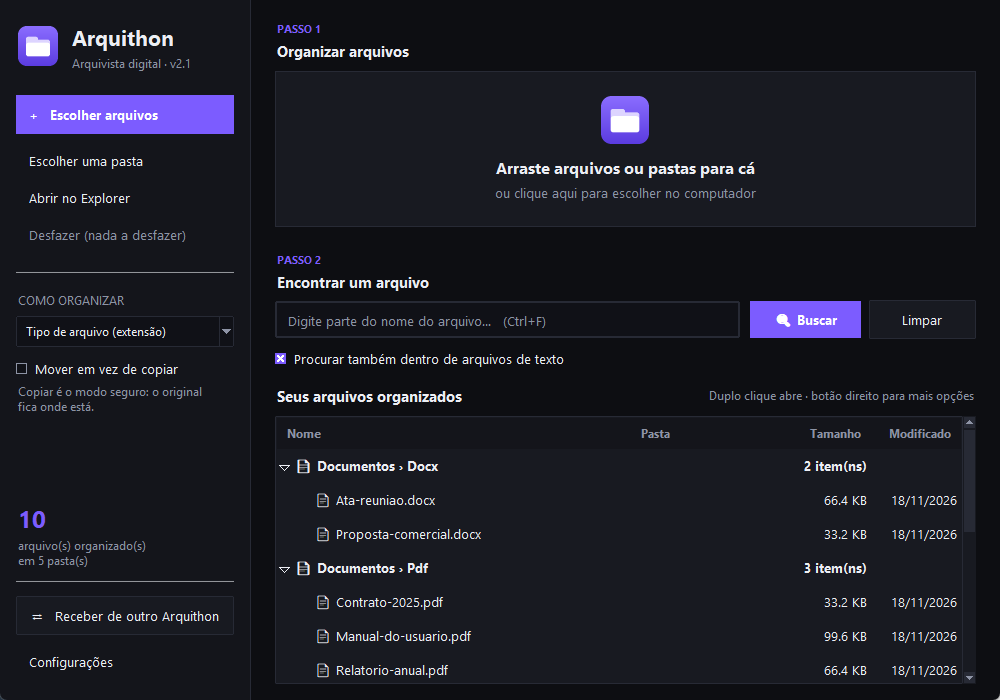
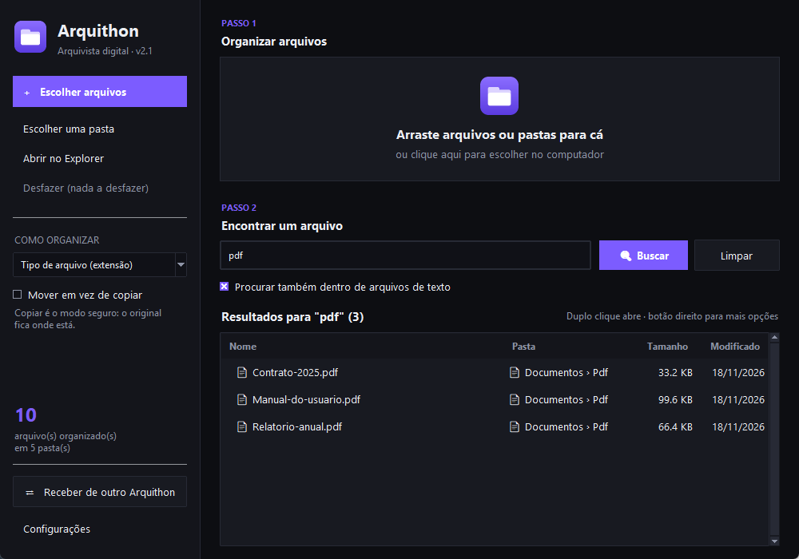
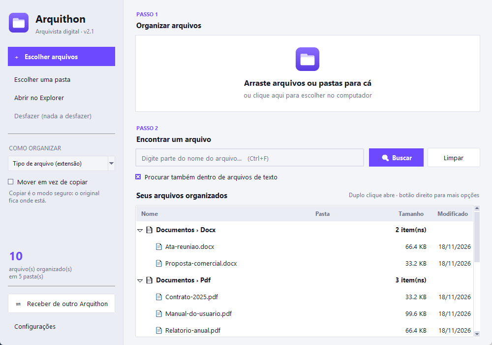

# Arquithon 2.1, o Arquivista em Python

Arquithon é um aplicativo para Windows, feito em Python com Tkinter, que organiza seus arquivos automaticamente por tipo, data, nome ou tamanho. Não tem login, não abre navegador e não precisa de internet nem de servidor. É só abrir e usar.



## Como usar em 3 passos

1. **Organizar.** Arraste arquivos ou pastas para a caixa do **Passo 1**, ou clique nela (ou em **+ Escolher arquivos**) para escolher no computador. Cada arquivo é copiado para a subpasta certa dentro de `uploads/`.
2. **Encontrar.** Digite parte do nome no campo do **Passo 2** e aperte Enter. A busca olha o nome do arquivo, o nome da pasta e, se você marcar a opção, o conteúdo de arquivos de texto.
3. **Abrir.** Dê dois cliques em um arquivo para abri-lo no Explorer. O botão direito oferece **Abrir no Explorer** e **Excluir arquivo**.

Errou? O botão **Desfazer** na barra lateral volta as últimas organizações, uma por vez (até 5 seguidas).



## O que tem na tela

| Lugar | Para que serve |
|---|---|
| **+ Escolher arquivos** | Abre o seletor de arquivos (atalho `Ctrl+O`). |
| **Escolher uma pasta** | Organiza uma pasta inteira, incluindo as subpastas. |
| **Abrir no Explorer** | Abre a pasta `uploads/` com tudo que já foi organizado. |
| **Desfazer** | Mostra quantas organizações dá para desfazer e volta a mais recente. Cópias são apagadas; arquivos movidos voltam para onde estavam. |
| **Como organizar** | Por tipo de arquivo, data de modificação, nome ou tamanho. A escolha fica salva. |
| **Mover em vez de copiar** | Tira o arquivo da origem. O app pede confirmação antes. Copiar é o padrão e o modo seguro. |
| **Contador** | Quantos arquivos já estão organizados e em quantas pastas. |
| **Receber de outro Arquithon** | Traz para cá tudo que outro Arquithon já organizou (veja abaixo). |
| **Configurações** | Tema claro/escuro, tamanho da fonte, se "Mover" já vem marcado e se a janela reabre no mesmo lugar. |

Ao fim de cada organização aparece um resumo do que foi para onde, com os botões `OK`, `Abrir pasta` e `Reverter`. Se dois arquivos tiverem o mesmo nome, o segundo ganha um sufixo `(2)`, `(3)`... e nada é sobrescrito.



## Receber o repositório de outro Arquithon

Serve para juntar os arquivos de dois Arquithons, por exemplo o de outro computador ou de um pendrive.

1. Clique em **Receber de outro Arquithon**, embaixo na barra lateral.
2. Escolha a pasta onde está o outro Arquithon (a que tem o `.exe` e a pasta `uploads/`) ou diretamente a pasta `uploads/` dele.
3. Confirme. O app mostra quantos arquivos serão copiados.

O que acontece:
- Os arquivos chegam nas mesmas subpastas em que estavam lá.
- Nada na origem é alterado.
- Arquivos idênticos aos que você já tem são ignorados.
- Arquivos diferentes com o mesmo nome ganham o sufixo `(2)`.
- O recebimento entra no **Desfazer**, como uma organização normal.
- O app recusa receber a própria pasta.

## Como os arquivos são separados

Por tipo, imagens vão para `imagens/png`, documentos para `documentos/pdf`, músicas para `multimedia/audio` e assim por diante. O dicionário de extensões cobre imagens, documentos, planilhas, apresentações, e-books, áudio, vídeo, compactados, código-fonte, design/CAD, executáveis e fontes. Extensões fora do mapa vão para `outros/<extensão>`.

Também dá para organizar por data (pastas de ano e mês), por nome (ordem alfabética) ou por tamanho (pequenos, médios e grandes).

Tudo que você escolhe (critério, tema, fonte, busca no conteúdo) fica salvo em `config.json`, ao lado do programa.

## Versões lado a lado

A pasta do projeto pode ter dois executáveis:

- `Arquithon antigo.exe`: a versão anterior, com o layout antigo.
- `Arquithon-2.1v.exe`: esta versão.

Cada executável usa a pasta `uploads/` e o `config.json` que estão **na mesma pasta que ele**. Deixando os dois juntos, eles enxergam os mesmos arquivos organizados.

Um `.exe` é uma cópia congelada do código no dia em que foi gerado. Por isso ele não muda quando o código muda, e para ter as novidades é preciso gerar de novo (veja abaixo).

## Rodando a partir do código

Com o Python instalado:

```bash
python app.py
```

Não é preciso instalar nenhuma biblioteca para isso.

## Gerando o executável

```bash
pip install -r requirements.txt
python -m PyInstaller Arquithon.spec
```

O programa sai em `dist/Arquithon-2.1v.exe`, já com o ícone do Arquithon. O ícone é desenhado em código (`ui/icon.py`) e o `.ico` é gerado automaticamente durante o build. Copie o `.exe` para a pasta onde quer manter seus arquivos organizados.

## Tecnologia

Tudo usa apenas a biblioteca padrão do Python:

- `tkinter`: janelas, listas, botões e temas.
- `shutil` e `os`: copiar, mover e ler pastas.
- `json`: preferências em `config.json`.
- `dataclasses`: dados do índice de busca.
- `ctypes`: arrastar e soltar direto pela API do Windows, sem `tkinterdnd2`. Fora do Windows, a caixa de soltar não aparece e os botões da barra lateral continuam funcionando.
- `zlib` e `struct`: geram o ícone em PNG e `.ico` sem precisar de Pillow.
- `unittest`: testes automatizados.

O PyInstaller, listado em `requirements.txt`, só é usado para gerar o `.exe`.

## Estrutura do projeto

```
arquithon/
├── app.py                 ponto de entrada, só sobe a janela
├── core/                  regra de negócio, sem Tkinter
│   ├── paths.py            onde ficam uploads/ e config.json
│   ├── config.py           leitura/escrita do config.json
│   ├── organizer.py        extensões, critérios de organização e desfazer
│   ├── importer.py         receber o repositório de outro Arquithon
│   ├── search.py           indexação e busca
│   └── fs_utils.py         abrir pastas/arquivos no Explorer
├── ui/                    interface Tkinter, consome o core
│   ├── styles.py           paleta e fontes dos temas claro e escuro
│   ├── icon.py             ícone desenhado em código (janela, logo e .exe)
│   ├── dnd.py              arrastar e soltar (API do Windows)
│   ├── result_dialog.py    resumo de "o que foi para onde"
│   ├── settings_dialog.py  tela de configurações
│   ├── window_state.py     lembra tamanho e posição da janela
│   ├── app_window.py       janela principal
│   └── main_frame.py       barra lateral, passos 1 e 2 e lista de arquivos
├── tests/                 testes de core/ (unittest)
├── docs/screenshots/      prints usados neste README
├── Arquithon.spec         configuração do PyInstaller
├── requirements.txt       dependência de build (pyinstaller)
└── uploads/               arquivos organizados (criado ao usar)
```

Para rodar os testes: `python -m unittest discover`.

## Status

O projeto já passou por uma versão web (Flask + HTML, com deploy em nuvem) e por uma versão com login por usuário. A versão atual prioriza simplicidade: um aplicativo offline, sem contas e sem servidor, para uso pessoal direto na máquina.
